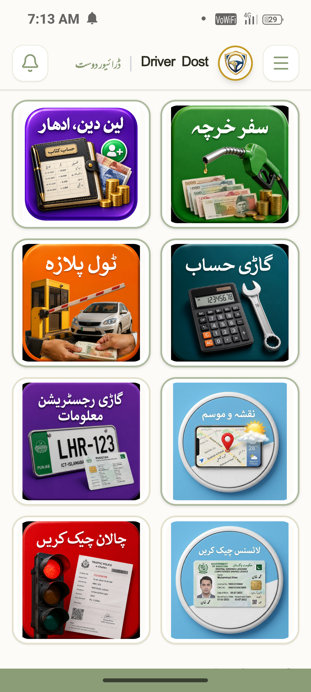
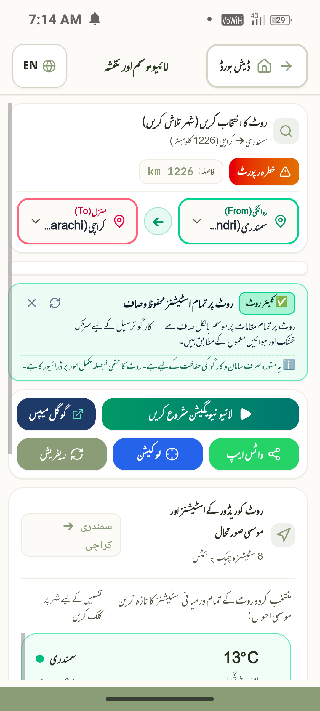
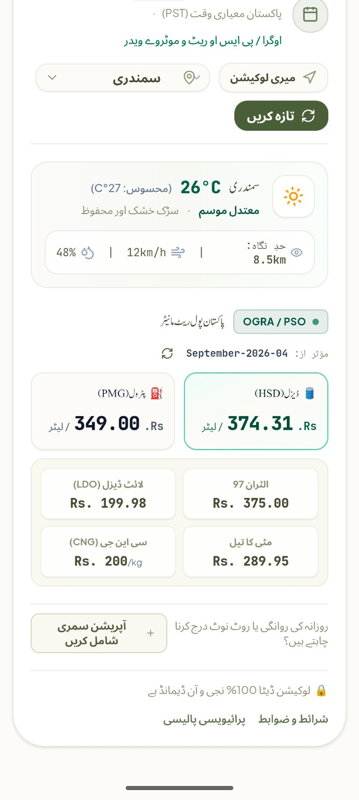
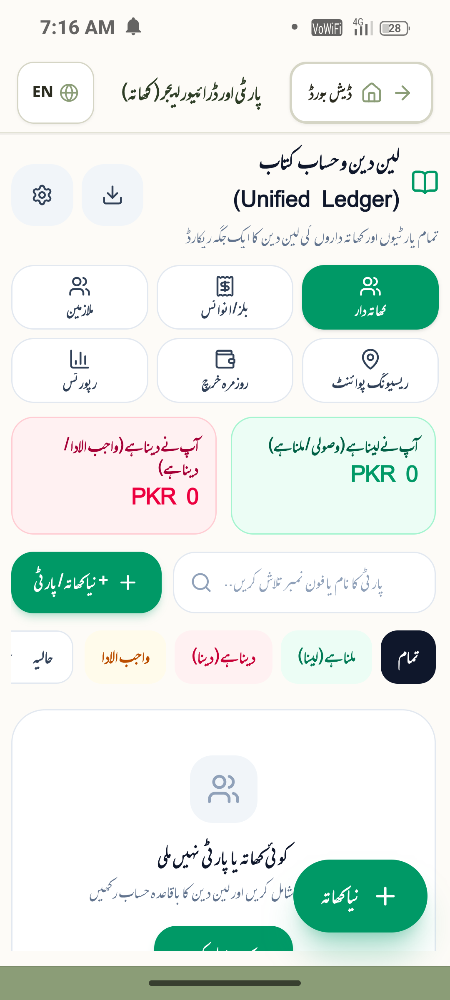

<div align="center">


# 🚚 Driver Dost | ڈرائیور دوست

### Your Road-Freight & Fleet Companion for Pakistan
### پاکستان کے ڈرائیورز اور ٹرانسپورٹرز کے لیے ایک مکمل ڈیجیٹل ساتھی

**Plan smarter. Track expenses. Manage fleet accounts.**  
**منصوبہ بندی کریں، اخراجات سنبھالیں، گاڑیوں اور کھاتوں کا مکمل حساب رکھیں۔**


**Published by Warraich Goods Transport Company**  
Samundri, Punjab, Pakistan

[🌐 Open Web App](https://zahdan-443.github.io/Warraich-Goods/) · [🔐 Privacy Policy](public/privacy.html) · [📄 Terms & Conditions](public/terms.html)

</div>

---

## 📱 App Screenshots

<div align="center">

### Home Dashboard | مین ڈیش بورڈ


### Live Weather & OGRA/PSO Fuel Rates | موسم اور پیٹرولیم ریٹس


### Route Weather & Live Navigation | روٹ موسم اور نیویگیشن


### Unified Ledger & Udhar Book | لین دین اور ادھار کھاتہ


</div>

---

## 👋 About Driver Dost

**Driver Dost (ڈرائیور دوست)** is a free, bilingual, offline-first road-freight and fleet management app built for drivers, truck owners, fleet operators and transport managers in Pakistan.

From calculating trip fuel expenses and NHA toll estimates to managing party/driver ledgers (`لین دین، ادھار`), per-vehicle accounts (`گاڑی حساب`), profit & loss (`گاڑی P&L`), live weather advisories, and quick access to MTMIS, DLIMS, and e-Challan verification portals, Driver Dost brings daily transport operations into one clean Urdu/English interface. Core tools work seamlessly in **Guest Mode without signing in**.

> **Independent app notice:** Driver Dost is privately owned and published by **Warraich Goods Transport Company**. It is **not a government app** and does not represent or affiliate with any government agency, Excise department, Punjab Police, or Safe Cities Authority.

---

## ✨ Key Features

| Module / Feature | Description |
|---|---|
| 🏠 **8-Module Home Dashboard** | Quick bilingual access to **لین دین، ادھار**, **سفر خرچہ**, **ٹول پلازہ**, **گاڑی حساب**, **گاڑی رجسٹریشن معلومات**, **نقشہ و موسم**, **چالان چیک کریں**, and **لائسنس چیک کریں**. |
| 📒 **Unified Ledger (لین دین و حساب کتاب)** | Track payables (`آپ نے دینا ہے`) and receivables (`آپ نے لینا ہے`) across parties (`کھاتہ دار`), staff (`ملازمین`), bills/invoices (`بلز/انوائس`), daily expenses (`روزمرہ خرچ`), receiving points (`ریسیونگ پوائنٹ`), and ledger reports (`رپورٹس`). |
| 🚛 **Vehicle Khata & P&L (گاڑی حساب کھاتہ)** | Manage per-vehicle revenue (`حاصل شدہ آمدن و کرایہ جات` for outbound & return freight), trip expenses, daily logs (`روزنامچہ`), and **Vehicle Profit & Loss (`گاڑی P&L`)** by registration number. |
| 🧮 **Trip Expense Calculator (ٹرپ خرچ کیلکولیٹر)** | Calculate route distance (`KM`), fuel consumption (`KM/L`), current diesel/fuel cost (`PKR`), route comparisons (`کم خرچ بمقابلہ تیز ترین`), and maintain a trip diary (`سفر ڈائری`). |
| 🛣️ **NHA Toll Plaza Calculator (ٹول پلازہ کیلکولیٹر)** | Estimate route-based NHA tolls by vehicle category (`Cat-1` to heavy categories) with **M-Tag Active** status and 50% non-M-Tag cash surcharge visibility. |
| 🌦️ **Live Route Weather & Navigation (نقشہ و موسم)** | View city weather, feels-like temperature, humidity, wind speed, visibility, corridor station forecasts, cargo safety advisories (`کلیئر روٹ`), road hazard alerts (`خطرہ رپورٹ`), Google Maps handoff, and WhatsApp location sharing. |
| ⛽ **OGRA / PSO Fuel Rate Monitor** | Check reference prices per litre/kg for **Petrol (PMG)**, **Diesel (HSD)**, **Light Diesel (LDO)**, **Altron 97**, **CNG**, and **Kerosene** with GPS or manual city selection. |
| 🔗 **MTMIS, Licence & E-Challan Portals** | Direct in-app guide and quick links to official verification portals such as **MTMIS Excise** (`mtmis.excise.punjab.gov.pk`), driving licence verification, and traffic e-challan portals. |
| 📅 **Document Expiry Reminders** | Set reminders for vehicle registration, route permits, fitness certificates, and driving licences at 30, 15, and 7 days before expiry. |
| 🎥 **Optional Dashcam & Document Tools** | Optional local dashcam recording with persistent notification, OCR document scanning, PDF export, sensitive-data masking, and WhatsApp sharing. |
| 🌐 **Urdu RTL & English Toggle** | Designed primarily for effortless **Urdu right-to-left (RTL)** usability with instant one-tap switching between Urdu and English (`EN`). |
| 📶 **Offline-First & Guest Mode** | Core calculators, ledgers, and vehicle records work offline on your device without mandatory login; optional Google Sign-In enables cloud backup. |

*Features and third-party online data availability may vary by device, connection, location, and external portal uptime.*

---

## 🔒 Privacy at a Glance

- **Guest Mode:** Ledgers, trip calculations, and vehicle records remain stored locally on the user's device.
- **Google Sign-In:** Supported records can sync securely to the user's private Firebase account.
- **Dashcam:** Recordings stay locally on the device and are never uploaded by the app.
- **Location:** Used only in the foreground with user permission for weather, route distance, and navigation assistance; manual city selection is always available.
- **Road Hazards:** Submitted hazard reports (`خطرہ رپورٹ`) may be visible to other signed-in users for 24 hours and are linked internally to the submitting account.
- **No Ads & No Data Selling:** Driver Dost contains no advertisements and does not sell user data.

Read the [Privacy Policy](public/privacy.html) for full details and the [Terms & Conditions](public/terms.html) for usage rules and disclaimers.

---

## 🌐 Languages | زبانیں

Driver Dost supports **Urdu (اردو)** with full right-to-left (RTL) layout and **English**, allowing drivers, munshis, and fleet owners to switch languages anytime from the top bar.

یہ ایپ مکمل اردو (RTL) اور انگریزی دونوں زبانوں میں دستیاب ہے تاکہ ڈرائیور حضرات اور ٹرانسپورٹ مالکان آسانی سے اپنے روزمرہ حساب کتاب اور سفر کی منصوبہ بندی کر سکیں۔

---

## 📲 Platforms

- **Web App:** [Open Driver Dost](https://zahdan-443.github.io/Warraich-Goods/)
- **Android Package:** `com.warraichgoods.driverdost`
- **Android APK:** Built and released via the repository's GitHub Actions workflow.

---

## 🧰 Technology Stack

| Technology | Purpose |
|---|---|
| React 19 | User interface |
| TypeScript | Typed application code |
| Vite | Development server and production build |
| Tailwind CSS | Styling and responsive mobile-first UI |
| Firebase Authentication | Optional Google sign-in |
| Cloud Firestore | Cloud data sync and storage |
| Capacitor 8 | Android application wrapper and native capabilities |
| Vitest | Automated unit and logic tests |
| GitHub Pages | Web app hosting |
| GitHub Actions | Automated Android APK build and release |

---

## 🛠️ Run Locally

### Requirements

- Node.js **22 or newer**
- npm
- A Firebase project for sign-in and cloud-sync functionality

### Setup

```bash
git clone https://github.com/zahdan-443/Warraich-Goods.git
cd Warraich-Goods
npm ci
cp .env.example .env
```

Add your Firebase web configuration to `.env`:

```dotenv
VITE_FIREBASE_API_KEY=your_firebase_api_key
VITE_FIREBASE_AUTH_DOMAIN=your_project.firebaseapp.com
VITE_FIREBASE_PROJECT_ID=your_firebase_project_id
VITE_FIREBASE_STORAGE_BUCKET=your_storage_bucket
VITE_FIREBASE_MESSAGING_SENDER_ID=your_messaging_sender_id
VITE_FIREBASE_APP_ID=your_firebase_app_id

# Optional
VITE_FIREBASE_MEASUREMENT_ID=your_measurement_id
VITE_FIREBASE_APPCHECK_SITE_KEY=your_recaptcha_v3_site_key
VITE_FUEL_API_URL=https://your-api.example.com/fuel-prices
```

Start the development server:

```bash
npm run dev
```

### Validate and Build

```bash
npm run validate
npm run pipeline
```

> **Firebase security & API key hardening:** Restrict the browser API key in Google Cloud Console by HTTP referrers (`zahdan-443.github.io/*`, `warraichgoods.eu.cc/*`, and `localhost/*`), restrict Android keys by package name + SHA-1 (`com.warraichgoods.driverdost`), enable **Firebase App Check** (reCAPTCHA v3 / Play Integrity), and keep `firestore.rules` deployed. Never commit private keystores or service account credentials.

---

## 🤖 Android APK Release

Workflow: `.github/workflows/build-apk.yml`

Configure these GitHub repository secrets before running a signed release build:

| Secret | Description |
|---|---|
| `ANDROID_KEYSTORE_BASE64` | Base64-encoded release `.jks` keystore, on one line |
| `ANDROID_KEYSTORE_PASSWORD` | Keystore password |
| `ANDROID_KEY_ALIAS` | Key alias |
| `ANDROID_KEY_PASSWORD` | Key password |

### Release Checklist

1. Back up the keystore and passwords securely in more than one safe location.
2. Update the app version in `package.json` (Android `versionCode` is derived from it).
3. Run the Android APK Build & Release workflow.
4. Check the build output and verify the signing certificate fingerprint.
5. Register SHA-1 and SHA-256 fingerprints in Firebase for `com.warraichgoods.driverdost`, where required.

**Important:** Never upload the keystore or passwords to the repository.

---

## 🛣️ Roadmap

Potential future enhancements include:

- Automated OCR receipt scanning directly into vehicle expense entries
- Predictive maintenance & oil-change interval alerts by odometer/trip logs
- Multi-branch fleet role permissions for dispatchers and accountants
- Exportable monthly fleet summary statements (PDF / Excel)

Roadmap items are plans, not guaranteed delivery dates.

---

## 🛡️ Permissions

| Permission | Why It Is Needed |
|---|---|
| Internet / Network State | Live weather, route calculations, fuel-rate updates, portal links, and optional cloud sync |
| Foreground Location | GPS city detection, route distance, navigation assistance, and hazard reporting |
| Camera | Document scanning and optional dashcam recording |
| Microphone | Audio recording when optional dashcam audio is enabled |
| Notifications | Document expiry reminders and persistent recording indicator |

You can manage permissions anytime through device settings. Do not operate the app manually while driving.

---

## 🏛️ Third-Party Services

Driver Dost may use or link to:

- **Google Firebase** — authentication and cloud sync
- **Open-Meteo** — weather forecasts
- **OSRM** — route distance and path calculations
- **MTMIS / DLIMS / PSCA Portals** — external vehicle registration, driving licence, and e-challan verification portals

These services are independently operated. Driver Dost does not represent any government agency. Always verify official records directly with the relevant authority.

---

## 📬 Support & Contact

**Warraich Goods Transport Company**  
Samundri, Punjab, Pakistan

- **Email:** [warraichgoods43@gmail.com](mailto:warraichgoods43@gmail.com)
- **Phone:** +92 300 5370443
- **Website:** [https://warraichgoods.eu.cc](https://warraichgoods.eu.cc)
- **Web App:** [zahdan-443.github.io/Warraich-Goods](https://zahdan-443.github.io/Warraich-Goods/)

For privacy or data-deletion requests, email from the account email associated with your request with the subject **`Driver Dost - Request`**.

---

## 📜 Legal

- [Privacy Policy](public/privacy.html)
- [Terms & Conditions](public/terms.html)

---

## © Copyright

© 2026 **Warraich Goods Transport Company**. All rights reserved. Use of Driver Dost is subject to the [Terms & Conditions](public/terms.html).