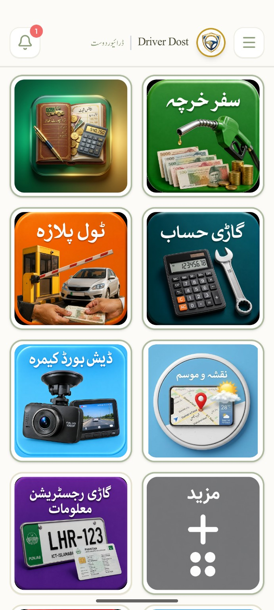
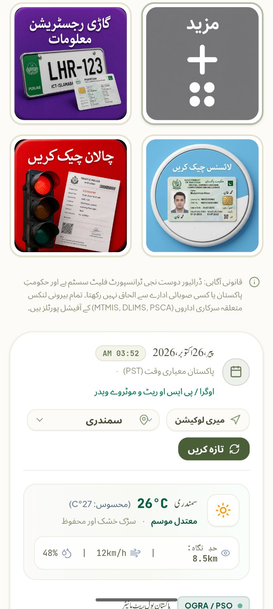
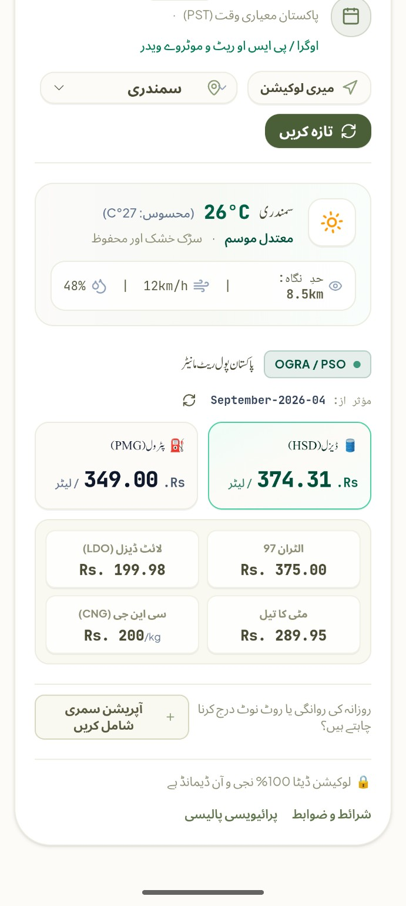

<div align="center">


# 🚚 Driver Dost | ڈرائیور دوست

### Your Road-Freight Companion for Pakistan
### پاکستان کے ڈرائیورز اور ٹرانسپورٹرز کے لیے ایک مفید ساتھی

**Plan smarter. Track expenses. Drive informed.**  
**منصوبہ بندی کریں، اخراجات سنبھالیں، باخبر سفر کریں۔**


**Published by Warraich Goods Transport Company**  
Samundri, Punjab, Pakistan

[🌐 Open Web App](https://zahdan-443.github.io/Warraich-Goods/) · [🔐 Privacy Policy](public/privacy.html) · [📄 Terms & Conditions](public/terms.html)

</div>

---

## 📱 App Screenshots

<div align="center">

### Home Screen


### Weather & Fuel Tools


### Weather & Fuel Details


</div>

---

## 👋 About Driver Dost

**Driver Dost (ڈرائیور دوست)** is a free, bilingual, offline-first road-freight and fleet utility app made for drivers, truck owners, fleet operators and transport managers in Pakistan.

From estimating trip expenses and checking fuel rates to keeping vehicle records and reviewing road-hazard reports, Driver Dost brings practical transport tools together in one place. Core tools can be used in **Guest Mode without signing in**.

> **Independent app notice:** Driver Dost is privately owned and published by Warraich Goods Transport Company. It is **not a government app** and is not affiliated with any government body.

## ✨ Features

| Feature | Description |
|---|---|
| 🧮 **Trip Expense Calculator** | Estimate fuel use and trip costs, with a PKR breakdown, return-trip option and additional route costs. |
| 🛣️ **Toll & Route Estimates** | Review estimated motorway/highway tolls and compare routes where multiple real route options are available. |
| 🌦️ **Weather Along the Route** | Check weather information and cargo-risk guidance for selected locations or a route. |
| ⛽ **Fuel Rate Reference** | View reference fuel prices to help plan trip expenses. Confirm current prices with official sources or fuel stations. |
| 🧭 **Navigation Assistance** | Optional foreground-location assistance for trip navigation. Location is not tracked in the background. |
| ⚠️ **Road Hazard Reports** | Share driver-reported hazards such as checkpoints, flooding, accidents, road closures and traffic. Reports stop displaying after 24 hours. |
| 🚛 **Fleet Records** | Keep vehicle, driver, fuel-log and per-vehicle expense records. |
| 📅 **Document Expiry Reminders** | Set reminders for registration, permits, fitness certificates and driving licences at 30, 15 and 7 days before expiry. |
| 🎥 **Optional Dashcam** | Manually start recording with a persistent recording notification. Recordings stay on the device. |
| 📄 **Document Tools** | Scan documents using OCR, export PDFs and share documents through WhatsApp. Sensitive details can be masked in exports. |
| 🔗 **Useful Portal Links** | Quick links to third-party vehicle, licence and e-challan portals, including MTMIS, DLIMS and PSCA where available. |
| 🌐 **Urdu & English** | Bilingual interface with Urdu right-to-left layout support. |
| 📶 **Offline-First Use** | Core tools are designed to work without an internet connection. Online services and cloud sync require connectivity. |
| 👤 **Guest Mode** | Start using core tools without creating an account or signing in. |

*Features and online data availability may vary by device, connection, location and third-party service.*

## 🔒 Privacy at a Glance

- **Guest Mode:** records remain on the user's device.
- **Google sign-in:** supported records can sync to the user's private Firebase account.
- **Dashcam:** recordings are stored locally on the device and are not uploaded by the app.
- **Location:** used only with permission while the app is open; manual city selection is available.
- **Road hazards:** submitted reports may be visible to other signed-in users and are linked internally to the submitting account.
- **No ads and no data selling:** Driver Dost does not display advertising or sell user data.

Read the [Privacy Policy](public/privacy.html) for full details and the [Terms & Conditions](public/terms.html) for usage rules and disclaimers.

## 🌐 Languages | زبانیں

Driver Dost supports **English and Urdu**, including right-to-left layout for Urdu screens.

ایپ اردو اور انگریزی دونوں زبانوں میں دستیاب ہے، تاکہ پاکستان کے ڈرائیورز اور ٹرانسپورٹرز اسے آسانی سے استعمال کر سکیں۔

## 📲 Platforms

- **Web app:** [Open Driver Dost](https://zahdan-443.github.io/Warraich-Goods/)
- **Android package:** `com.warraichgoods.driverdost`
- **Android APK:** built through the repository's GitHub Actions workflow.

## 🧰 Technology Stack

| Technology | Purpose |
|---|---|
| React 19 | User interface |
| TypeScript | Typed application code |
| Vite | Development server and production build |
| Tailwind CSS | Styling and responsive UI |
| Firebase Authentication | Google sign-in |
| Cloud Firestore | Cloud data sync and storage |
| Capacitor 8 | Android application integration |
| Vitest | Automated tests |
| GitHub Pages | Web app deployment |
| GitHub Actions | Automated Android APK build and release |

## 🛠️ Run Locally

### Requirements

- Node.js **22 or newer**
- npm
- A Firebase project for sign-in and cloud-sync functionality

### Setup

```bash
git clone https://github.com/zahdan-443/Warraich-Goods.git
cd Warraich-Goods
npm ci
cp .env.example .env
```

Add your Firebase web configuration to `.env`:

```dotenv
VITE_FIREBASE_API_KEY=your_firebase_api_key
VITE_FIREBASE_AUTH_DOMAIN=your_project.firebaseapp.com
VITE_FIREBASE_PROJECT_ID=your_firebase_project_id
VITE_FIREBASE_STORAGE_BUCKET=your_storage_bucket
VITE_FIREBASE_MESSAGING_SENDER_ID=your_messaging_sender_id
VITE_FIREBASE_APP_ID=your_firebase_app_id

# Optional
VITE_FIREBASE_MEASUREMENT_ID=your_measurement_id
```

Start the development server:

```bash
npm run dev
```

### Validate and Build

```bash
npm run validate
npm run pipeline
```

> **Firebase security:** Firebase web configuration keys are not server secrets. Keep Firestore security rules (`firestore.rules`) restrictive and deployed correctly. Never commit private credentials, keystores or passwords.

## 🤖 Android APK Release

Workflow: `.github/workflows/build-apk.yml`

Configure these GitHub repository secrets before running a signed release build:

| Secret | Description |
|---|---|
| `ANDROID_KEYSTORE_BASE64` | Base64-encoded release `.jks` keystore, on one line |
| `ANDROID_KEYSTORE_PASSWORD` | Keystore password |
| `ANDROID_KEY_ALIAS` | Key alias |
| `ANDROID_KEY_PASSWORD` | Key password |

### Release checklist

1. Back up the keystore and passwords securely in more than one safe place.
2. Update the app version in `package.json`. The Android `versionCode` is derived from that version.
3. Run the Android APK Build & Release workflow.
4. Check the build output and verify the signing certificate fingerprint.
5. Register SHA-1 and SHA-256 fingerprints in Firebase for `com.warraichgoods.driverdost`, where required.

**Important:** If the release keystore is lost, you may not be able to update existing installations signed with it. Never upload the keystore or passwords to the repository.

## 🛣️ Roadmap

Potential future improvements include:

- Party and broker ledgers
- Per-vehicle profit and loss reports
- Vehicle maintenance reminders
- Receipt scanning for vehicle expenses

Roadmap items are plans, not guaranteed delivery dates.

## 🛡️ Permissions

| Permission | Why it may be needed |
|---|---|
| Internet / Network State | Weather, routing, fuel-rate references and optional cloud sync |
| Foreground Location | Navigation assistance, nearby information and hazard reporting |
| Camera | Document scanning and optional dashcam |
| Microphone | Audio recording when optional dashcam audio is enabled |
| Notifications | Optional information digest and document-expiry reminders |

You can manage permissions through device settings. Do not operate the app manually while driving.

## 🏛️ Third-Party Services

Driver Dost may use or link to:

- **Google Firebase** — authentication and cloud sync
- **Open-Meteo** — weather information
- **OSRM** — route calculations
- **MTMIS / DLIMS / PSCA portals** — external vehicle, licence and e-challan information where available

These services are independently operated. Their availability, content, estimates and policies may change. Driver Dost does not represent any government agency. Verify official information with the relevant authority.

## 📬 Support & Contact

**Warraich Goods Transport Company**  
Samundri, Punjab, Pakistan

- **Email:** [warraichgoods43@gmail.com](mailto:warraichgoods43@gmail.com)
- **Phone:** +92 300 5370443
- **Web app:** [zahdan-443.github.io/Warraich-Goods](https://zahdan-443.github.io/Warraich-Goods/)

For privacy or data-deletion requests, email from the account email associated with your request and use the subject **`Driver Dost - Request`**.

## 📜 Legal

- [Privacy Policy](public/privacy.html)
- [Terms & Conditions](public/terms.html)

## © Copyright

© 2026 **Warraich Goods Transport Company**. All rights reserved. Use of Driver Dost is subject to the [Terms & Conditions](public/terms.html).
